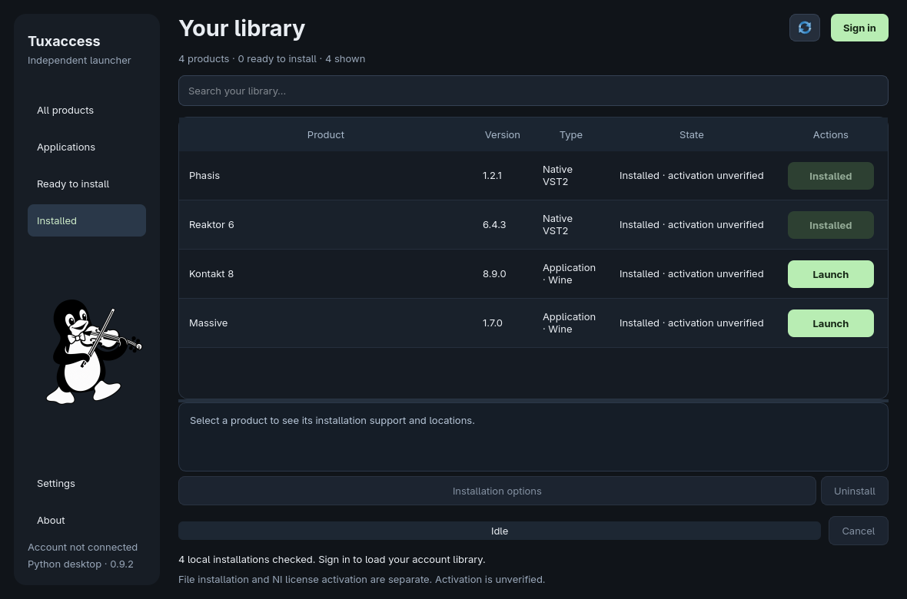

<div align="center">


# Tuxaccess

**Your Native Instruments collection, from Linux.**

An independent, unofficial launcher and product manager.

**Python 3.10+ · Qt / PySide6 · Arch Linux first · MIT**

[Get started](#quick-start) · [Current support](#current-support) · [Documentation](#documentation)

</div>

> **🚧 Work in progress — experimental software.**
>
> Tuxaccess is an early prototype, not a complete Native Access replacement.
> Installation, application startup, audio and activation are separate milestones.
> Support is limited to the products and versions documented below.



*The actual Qt interface on Arch Linux, showing locally verified files. Sign in
to load your account catalog. “Installed” does not confirm NI activation or
successful audio playback.*

## Why Tuxaccess?

Tuxaccess provides an alternative workflow where Native Access 2 is unavailable
or does not work on Linux. It brings account sign-in, your product catalog,
downloads and selected installation workflows into a native Linux interface.

- **Your collection in one place.** Sign in through NI's website in your browser;
  the account catalog loads automatically afterward.
- **A direct Install action.** Supported products use your saved download and
  installation settings, with progress, cancellation and retry in the main window.
- **Collections you can explore.** Open a Komplete collection to see its
  confirmed components and individual installation options.
- **Linux and Wine workflows.** Selected native VST2 packages and exact Windows
  application versions have separate, verified installation paths.
- **Simple by default, manual when needed.** Embedded Settings, product details
  and advanced tools expose paths and manual operations without a settings popup.
- **A little Tux.** One of thirteen musical illustrations welcomes you each
  session, avoiding an immediate repeat.

## Quick start

The desktop has been tested in an **Arch Linux QEMU VM**. A normal graphical
session, a browser and Python 3.10 or newer are required.

```sh
sudo pacman -S python python-pip firefox xdg-utils
git clone https://forgejo.my-cloud.me/My-Cloud/native-access.git
cd native-access
python -m venv .venv
.venv/bin/python -m pip install ".[desktop]"
.venv/bin/tuxaccess
```

1. Open **Settings** and choose your download and Wine-prefix locations.
2. Click **Sign in**, complete NI's page in your browser and allow it to open
   **Tuxaccess**. The sign-in banner stays inside the main window.
3. Find a product and click **Install**. Collections use **View products** first.
   A product without a supported workflow explains its limitation inline.
4. Use **Launch** for a supported installed application. To remove a managed
   installation, select it and use **Uninstall** in its details.

Some system dependencies require your distribution's authentication dialog.
Uninstall retains user projects, preferences and other retained prefix data;
the application shows their location. Existing manual installations are not
automatically adopted for removal.

Ubuntu and CentOS-family distributions are future targets, **not tested
platforms**. The Python environment approach is intended to be reusable, but
system dependencies differ and older releases may lack suitable Qt wheels.

## Current support

| Area | Verified result and current limit |
| --- | --- |
| Account and catalog | Fresh browser login and native HTTPS token exchange passed on Arch. Token refresh remains unverified. |
| Downloads | Authenticated Metalink resolution, streaming download, size and SHA-256 verification; no general resume/queue persistence yet. |
| Phasis 1.2.1 | Native VST2 installed and discovered in Carla; numerical audio-processing test passed. Activation and custom editor unverified. |
| Reaktor 6.4.3 | Native VST2 installed and discovered in Carla. Instrument playback, activation and custom editor unverified. |
| Kontakt 8.9.0 | Managed Wine installation and standalone startup observed. A prior demo produced measured audio; activation and DAW bridging unqualified. |
| Maschine 2.18.4 | Managed installation/removal verified. Editor startup still stalls at audio initialization in the test VM. |
| Massive 1.7 / Controller Editor 2.8.2 | Experimental exact-version profiles. Complete runtime qualification remains pending; Controller Editor is not enabled. |

Native Phasis and Reaktor packages contain **VST2 plug-ins, not standalone
applications**. An installation record verifies files; it does not establish
that every product feature, controller or audio host works.

Product updates, repair, arbitrary installer versions, broad distribution
support and authorized activation are unfinished. The current source passes
**208 unit tests on Arch**; this is not a compatibility guarantee for the catalog.

## Independence and ownership

Tuxaccess is **not affiliated with, endorsed by, or supported by Native
Instruments**. Native Instruments, Native Access and product names belong to
their respective owners and identify the software this project works with.

The launcher is [MIT-licensed](LICENSE). NI applications remain proprietary,
subject to their own licenses, account requirements and activation. NI software
and NI artwork are not included or relicensed. Tuxaccess does not grant product
licenses or bypass activation. Its name and these notices do not establish
legal clearance or immunity from claims.

Sign-in currently reuses Native Access's observed public OAuth client ID and
registered redirects. Tuxaccess has **no independent NI-issued client
registration or NI endorsement**. Your password is entered on NI's website;
account tokens stay in process memory. A different client ID requires a
compatible registration accepted by NI's authorization server.

## Upgrading from Native Access Linux

Tuxaccess was previously named Native Access Linux. For an existing virtual
environment with the old distribution installed:

```sh
.venv/bin/python -m pip uninstall native-access-linux-prototype
.venv/bin/python -m pip install ".[desktop]"
.venv/bin/tuxaccess
```

The old `native-access-linux` command remains an alias. Existing settings,
download locations, Wine prefixes, installed records and internal data paths
retain their previous names to preserve installations. The `native-access`
callback URI remains part of the observed NI sign-in protocol. Historical
investigation reports also retain the former project name.

## Development

The prototype stays in Python while its behavior and interfaces are tested.
From the source directory:

```sh
python launcher.py
QT_QPA_PLATFORM=offscreen python -m unittest discover -s tests -v
```

Tests use mocks for account operations and do not contact NI. Optional read-only
reference queries require a running NTK daemon on a loopback endpoint:

```sh
python launcher.py --probe
python launcher.py --inspect catalog
python launcher.py --inspect preferences
python launcher.py --inspect-package package.deb --expected-sha256 HASH
```

The reference bridge is a development aid, **not required for Linux browser
sign-in**. There is no native Linux NI daemon implementation in this project.

## Documentation

| Read about | Guide |
| --- | --- |
| Interface and product actions | [Desktop workflow](docs/ui-workflow.md) · [Collections](docs/bundle-workflow.md) |
| Installation and compatibility | [Native VST2 installation](docs/native-installation.md) · [Wine management](docs/wine-management.md) · [Kontakt testing](docs/kontakt-wine-testing.md) |
| Test environment and evidence | [Arch VM verification](docs/arch-vm-verification.md) · [Development verification](docs/verification-0.9.md) · [Tuxaccess 0.9.2](docs/verification-0.9.2.md) |
| Authentication and interfaces | [Browser sign-in investigation](docs/auth-login-debug.md) · [Protocol findings](docs/protocol-findings.txt) |
| Packaging and artwork | [Language and packaging](docs/language-and-packaging.md) · [Sidebar artwork](docs/sidebar-art.md) |
